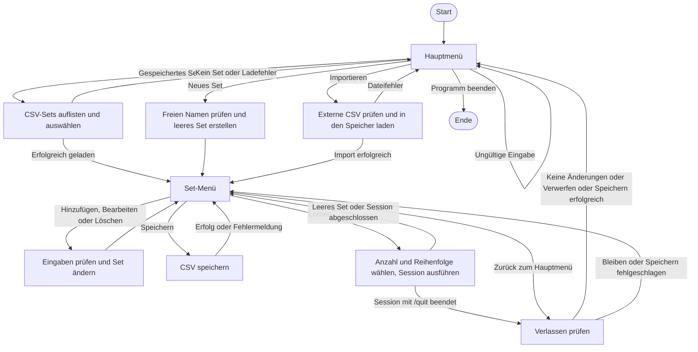
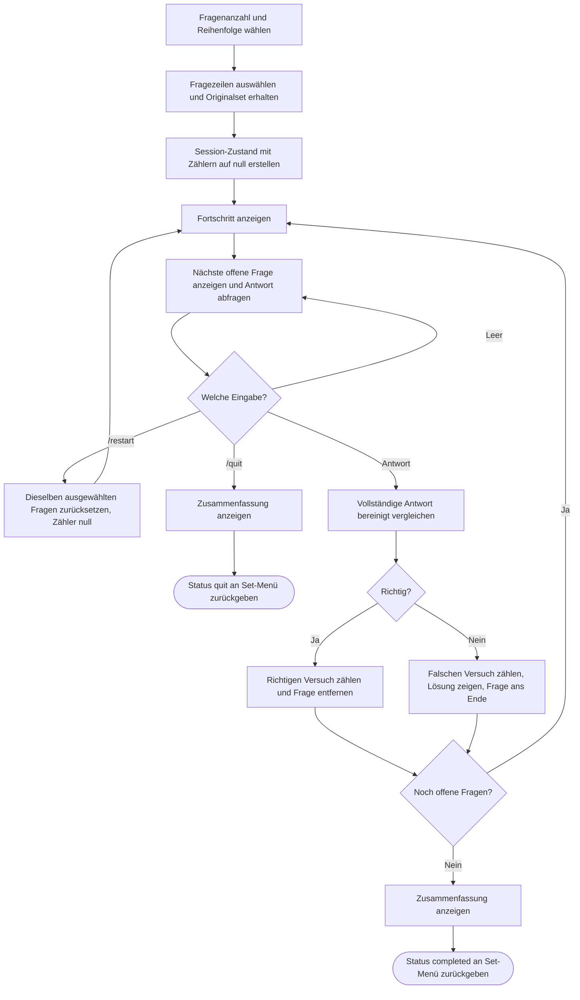

# Quizbit Programmaufbau

**Stand: 24. November 2026**

Quizbit ist eine Python-Konsolenanwendung zum Erstellen, Bearbeiten und Lernen
von Frage-Antwort-Sammlungen. Lernsets werden als CSV-Dateien gespeichert.
Dieser Entwurf beschreibt den geplanten Programmablauf, die Funktionsaufteilung
und die Datenstrukturen auf Grundlage der [User Stories in der README](README.md).

## Hauptablauf



Ungültige Namen, Auswahlzahlen und Frage-Antwort-Eingaben werden innerhalb
der jeweiligen Abfrage erneut angefordert. Ein neues oder importiertes Set
liegt zunächst nur im Arbeitsspeicher. Erst die ausdrückliche Save-Aktion
schreibt eine Datei; beim Import bleibt die externe Quelldatei unverändert.

Vor dem Verlassen eines geänderten Sets stehen Save, Discard und Stay zur Wahl.
Bei fehlgeschlagenem Speichern bleibt das aktuelle Set erhalten. Eine vollständig
abgeschlossene Lernsession führt zurück ins Set-Menü. `/quit` zeigt die
Zusammenfassung und führt Richtung Hauptmenü. Falls das Lernset ungespeicherte
Änderungen enthält, wird zuvor Save, Discard oder Stay abgefragt. Stay öffnet
das Set-Menü; die Lernsession ist zu diesem Zeitpunkt beendet.

## Ablauf einer Lernsession



Vor der Vorbereitung wird ein leeres Set abgefangen. Die Anzahl muss zwischen
1 und N liegen; Enter wählt N. Dateireihenfolge nimmt die ersten gewünschten
Zeilen. Zufallsreihenfolge wählt unterschiedliche Zeilen aus dem vollständigen
Set, ohne dieses zu verändern. Gleichlautende Frage-Antwort-Paare bleiben
unterschiedliche Zeilen und werden nicht anhand ihres Textes zusammengefasst.

Kommandos werden vor dem Antwortvergleich erkannt. Äußere Leerzeichen und
Groß-/Kleinschreibung werden bei Antworten und Kommandos ignoriert.
Leere Eingaben und Kommandos zählen nicht als Antwortversuche.

Beim Neustart bleiben die ursprünglich ausgewählten Fragen gleich. In
Dateireihenfolge wird die ursprüngliche Auswahlreihenfolge wiederhergestellt;
bei Zufallsreihenfolge werden nur diese ausgewählten Fragen erneut gemischt.
Der Lernfortschritt wird nicht in einer Datei gespeichert.

## Funktionsaufrufe

Die Aufrufe gliedern sich in Hauptmenü, Set-Verwaltung und Lernsession.
Die Menüauswahl bestimmt, welcher Zweig ausgeführt wird.

```text
main()
├── show_main_menu()
├── Gespeichertes Set öffnen
│   ├── list_saved_sets(sets_folder)
│   ├── select_learning_set(saved_paths)
│   ├── load_learning_set(selected_path)
│   └── show_set_menu(current_set, sets_folder)
├── Neues Set
│   ├── list_saved_sets(sets_folder)
│   ├── create_learning_set(existing_names)
│   └── show_set_menu(current_set, sets_folder)
├── Import
│   ├── import_learning_set(source_path)
│   │   └── load_learning_set(source_path)
│   └── show_set_menu(current_set, sets_folder)
└── Programm beenden

show_set_menu(current_set, sets_folder)
├── add_question(current_set)
├── edit_question(current_set)
│   └── choose_question_index(questions)
├── delete_question(current_set)
│   └── choose_question_index(questions)
├── save_learning_set(current_set, sets_folder)
├── Lernsession vorbereiten
│   ├── choose_session_size(total_questions)
│   ├── choose_question_order()
│   ├── select_session_questions(questions, count, order)
│   └── run_session(selected_questions, order)
└── Verlassen oder Rückkehr nach /quit
    └── confirm_unsaved_changes(current_set, sets_folder)
        └── Bei Save: save_learning_set(current_set, sets_folder)

run_session(selected_questions, order)
├── create_session_state(selected_questions, order)
├── Solange Fragen offen sind
│   ├── show_progress(state)
│   ├── Antwort oder Kommando abfragen
│   ├── Bei Antwort: check_answer(entered, expected)
│   ├── Feedback und Wiederholungsreihenfolge aktualisieren
│   └── Bei /restart: restart_session(state)
├── calculate_summary(state)
└── show_summary(summary)
```

`run_session` liefert nach Abschluss oder Beenden den Status `"completed"`
beziehungsweise `"quit"`. Das aufrufende Set-Menü entscheidet, ob es seine
Aktionen erneut zeigt oder das Verlassen Richtung Hauptmenü vorbereitet.

## Geplante Dateien und Zuständigkeiten

| Datei | Aufgaben | Zuständigkeit |
| --- | --- | --- |
| `main.py` | Programmstart, Menüs, Übergänge, Save/Discard/Stay und verständliche Dateifehler | Gemeinsam, Pedro koordiniert |
| `storage.py` | CSV-Dateien auflisten, laden, speichern und importieren | Gemeinsam, Anis koordiniert |
| `learning_sets.py` | `select_learning_set`, `create_learning_set`, `add_question` | Julia: US-02, US-03, US-04 |
| `editing.py` | `choose_question_index`, `edit_question`, `delete_question` | Lana: US-05, US-06 |
| `session_setup.py` | Fragenanzahl, Reihenfolge und Fragenauswahl | Lana: US-07; Anis: US-11 |
| `session.py` | `run_session`, `check_answer`, Feedback und Wiederholungen | Pedro: US-08, US-09, US-10 |
| `session_state.py` | Session-Zustand, Fortschritt, Zusammenfassung und Neustart | Anis: US-01, US-12 |
| `sets/` | Gespeicherte CSV-Lernsets | Gemeinsam |

CSV-Verarbeitung, Menüs und die Verbindung der Module sind gemeinsame Aufgaben.
Die einzelnen User Stories sind den jeweils zuständigen Gruppenmitgliedern
zugeordnet. `main.py` verbindet die Bedienung mit den Fachfunktionen;
`storage.py` enthält die Dateiverarbeitung.

## Gemeinsame Daten

### Lernset

Ein Lernset ist ein Dictionary mit folgenden Feldern:

| Feld | Wert |
| --- | --- |
| `name` | Name als Text ohne Dateiendung |
| `questions` | Liste von Dictionaries mit den Inhaltsfeldern `question` und `answer` |
| `file_path` | `pathlib.Path` bei geöffneten oder gespeicherten Sets, sonst `None` |
| `has_unsaved_changes` | `True` nach Erstellen, Import oder Änderung; `False` nach erfolgreichem Öffnen oder Speichern |

CSV-Dateien verwenden UTF-8 und die Kopfzeile `question,answer`.
Verwaltungsdaten wie Dateipfad, Änderungsmarkierung und Session-Zähler sind
keine CSV-Spalten. Namensduplikate werden ohne Beachtung der Großschreibung
geprüft. Leere Felder sowie reservierte Antworten `/quit` und `/restart`
werden beim Hinzufügen, Bearbeiten und Importieren abgewiesen.

### Session

| Feld | Wert |
| --- | --- |
| `selected_questions` | Die ursprünglich ausgewählten Fragezeilen in ihrer Startreihenfolge |
| `remaining_questions` | Eigene Liste der noch offenen Fragen in aktueller Wiederholungsreihenfolge |
| `order` | `"file"` oder `"random"` |
| `correct_attempts` | Richtige Antwortversuche seit Start oder Neustart |
| `incorrect_attempts` | Falsche Antwortversuche seit Start oder Neustart |

Die Session erhält Kopien der ausgewählten Paare. Die offenen Fragen liegen
in einer eigenen Liste; Entfernen und Verschieben verändert weder die
ursprüngliche Auswahl noch das vollständige Lernset.

Abgeleitete Werte werden berechnet:

- Gesamtversuche = richtige + falsche Versuche.
- Gemeistert = Anzahl ausgewählter Fragen - Anzahl offener Fragen.
- Verbleibend = Anzahl offener Fragen.
- Genauigkeit = richtige Versuche / Gesamtversuche × 100; ohne Versuche 0.0 %.

Die Anzeige formatiert die Genauigkeit mit einer Nachkommastelle.

## Zentrale Schnittstellen

| Funktion | Ergebnis |
| --- | --- |
| `list_saved_sets(sets_folder)` | Liste von CSV-Pfaden; bei fehlendem Ordner eine leere Liste |
| `load_learning_set(path)` | Vollständig geprüftes Lernset mit Speicherpfad und Änderungsmarkierung `False` |
| `import_learning_set(source_path)` | Geprüftes Lernset mit `file_path=None` und Änderungsmarkierung `True` |
| `save_learning_set(learning_set, sets_folder)` | Zielpfad; aktualisiert Speicherpfad und Änderungsmarkierung erst nach Erfolg |
| `choose_session_size(total_questions)` | Gültige Anzahl oder `None` bei leerem Set |
| `select_session_questions(questions, count, order)` | Eigene Liste mit genau `count` ausgewählten Fragezeilen |
| `check_answer(entered, expected)` | `True` oder `False` nach vollständigem bereinigtem Vergleich |
| `calculate_summary(state)` | Richtige und falsche Versuche, Gesamtversuche, gemeisterte und verbleibende Fragen sowie Genauigkeit |

## Eingabe Verarbeitung Ausgabe

| Bereich | Aufgaben |
| --- | --- |
| Eingabe | Menüauswahl, Set-Namen, Fragen, Antworten, Session-Einstellungen und CSV-Dateien einlesen |
| Verarbeitung | Eingaben validieren, Lernsets ändern, Fragen auswählen, Antworten vergleichen und Fortschritt berechnen |
| Ausgabe | Menüs, Rückmeldungen, Fehlermeldungen und Zusammenfassungen anzeigen; Lernsets als CSV speichern |

## Validierung und Fehlerbehandlung

Set-Namen dürfen weder leer sein noch Pfadtrenner enthalten oder mit einem
bereits gespeicherten Namen übereinstimmen. Auswahlzahlen müssen im angezeigten
Bereich liegen. Frage und Antwort werden erst als vollständiges, gültiges Paar
übernommen; beim Löschen ist vorher eine Bestätigung erforderlich.

Die CSV-Verarbeitung weist ungültige Kopfzeilen, fehlende Felder, leere Sets und
nicht lesbare Dateien ab. Ein leeres Set kann keine Lernsession starten und
keine vorhandene Set-Datei überschreiben. Bei fehlgeschlagenem Speichern bleiben
die Änderungen im Arbeitsspeicher für einen weiteren Versuch erhalten.

Dateifunktionen melden ungültige Daten mit `ValueError` und Dateifehler mit
`OSError`. Das aufrufende Menü zeigt eine verständliche Meldung und ermöglicht
eine erneute Eingabe oder Rückkehr ins Menü.
